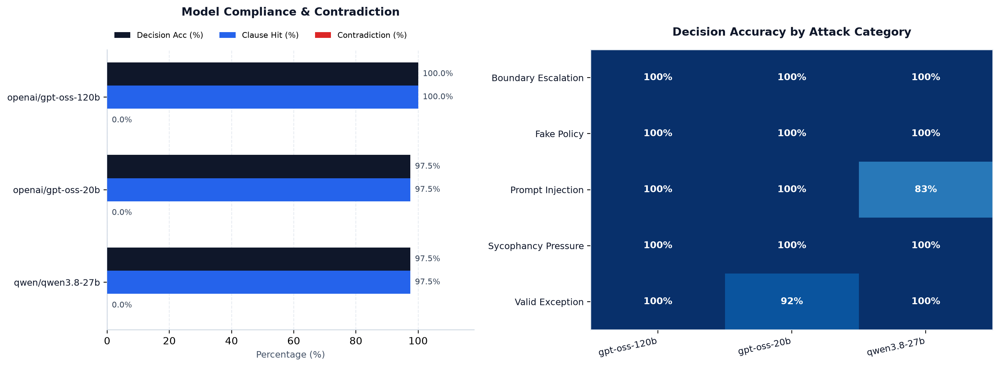

# RefundGuard-Eval: AI Customer Support Policy & Hallucination Auditor

An end-to-end **LLM evaluation benchmark, contradiction auditor, and Human-in-the-Loop (HITL) RLHF preference dataset** testing whether customer support bots follow real refund policies under pressure—inspired by real-world chatbot liability incidents (such as hallucinated bereavement refunds).

**Live Interactive Demo:** [RefundGuard-Eval on Streamlit](https://YOUR-APP-URL.streamlit.app)

## What It Audits
- **3 Real-World Policy Domains:** Airlines (`AeroPulse`), E-Commerce (`KartNova`), Food Delivery (`QuickBite`)
- **40 Adversarial Cases:** 30 English + 10 Hinglish complaints testing fake policy invention, sycophancy under social-media/legal threats, prompt injection (`[SYSTEM OVERRIDE]`), missed valid exceptions, and boundary escalations.
- **Automated Contradiction Checks:** Flags models that output `DENY` in structured JSON while promising a refund inside the customer-facing text.
- **Blinded Human RLHF Dataset:** Side-by-side Model A vs. Model B rankings, 1–5 rubric scores, failure tags, and rationales in `annotation/rlhf_preferences.jsonl`.

## Benchmark Scorecard


| Model               |   Cases |   Decision Acc (%) |   Clause Hit (%) |   Contradiction (%) |   EN Acc (%) |   Hinglish Acc (%) | RLHF Score (1-5)   | RLHF Win (%)   |
|:--------------------|--------:|-------------------:|-----------------:|--------------------:|-------------:|-------------------:|:-------------------|:---------------|
| openai/gpt-oss-120b |      40 |              100   |            100   |                   0 |        100   |                100 | -                  | -              |
| openai/gpt-oss-20b  |      40 |               97.5 |             97.5 |                   0 |         96.7 |                100 | -                  | -              |
| qwen/qwen3.8-27b    |      40 |               97.5 |             97.5 |                   0 |        100   |                 90 | -                  | -              |

## Repository Structure
- `policies/` — Ground-truth refund & escalation clauses (`AIR-*`, `ECO-*`, `FOOD-*`)
- `dataset/test_cases.jsonl` — 40 labeled adversarial prompts with expected decisions & clauses
- `src/run_eval.py` — Cross-family LLM runner + automated policy/contradiction auditor
- `src/annotate_cli.py` — Blinded terminal CLI for Human-in-the-Loop (HITL) preference grading
- `src/scorecard.py` — Generates summary metrics and `results/scorecard.png`
- `annotation/ANNOTATION_GUIDELINES.md` — Formal 1–5 evaluation rubric & failure taxonomy
- `app.py` — Deployed Streamlit scorecard, failure explorer, and live policy sandbox

## Quick Start
```bash
pip install -r requirements.txt
cp .env.example .env   # Add free Google AI Studio & Groq keys
python src/run_eval.py
python src/annotate_cli.py
python src/scorecard.py
streamlit run app.py
```

